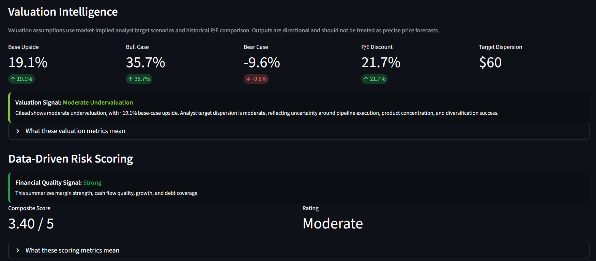

# 📊 Gilead Intelligence Dashboard

A data-driven investment intelligence dashboard for **Gilead Sciences (GILD)** that combines market data, SEC financials, business segment exposure, pipeline insights, valuation, capital allocation, and risk modeling into a unified security intelligence framework.

---

## 🚀 Overview

This dashboard goes beyond traditional stock analysis by integrating:

- 📈 Market performance, volatility, momentum, and drawdown analysis
- 🧾 SEC financial baseline and financial quality metrics
- 🏢 Business segment concentration and product exposure
- 🧪 Pipeline intelligence and strategic watchlist tracking
- 🌍 FX exposure and estimated revenue sensitivity
- 📰 News and filings monitoring
- 📊 Valuation scenarios using bear, base, and bull cases
- 🧠 Composite risk and intelligence scoring
- 🎯 Risk-adjusted expected return modeling
- 📄 PDF intelligence brief export

---

## Dashboard Preview



---

## 🧠 Key Features

### 1. Expected Return Model

The expected return model produces a probability-weighted price target and then adjusts the return estimate using business-specific and risk-based factors.

Key outputs include:

- Bear, base, and bull price target scenarios
- Probability-weighted expected price target
- Raw expected return
- Diversification adjustment
- Capital allocation adjustment
- Segment role adjustment
- Forward revenue mix adjustment
- Risk haircut
- Final risk-adjusted return signal
- Confidence score

---

### 2. Intelligence Risk Engine

The intelligence risk engine combines multiple dimensions into a unified score:

- Market risk from volatility, drawdown, and trend behavior
- Product concentration risk from HIV revenue exposure
- FX exposure from foreign-currency-denominated sales
- Pipeline execution and maturity risk
- News and filings risk
- SEC risk factor intensity
- Strategic alignment risk

The goal is to create a security-level view that connects market behavior, company fundamentals, and forward-looking business risks.

---

### 3. Business Segment Analysis

The business segment module tracks Gilead's revenue mix and concentration profile.

It includes:

- Total product sales
- HIV sales and HIV concentration
- Top-three segment concentration
- Core, growth, legacy, and other segment classification
- Growth exposure
- Declining exposure
- Forward mix projection

This helps highlight the importance of Gilead's HIV franchise while also evaluating the company's diversification path.

---

### 4. Pipeline Intelligence

The pipeline intelligence module evaluates Gilead's clinical and strategic pipeline position.

It includes:

- Clinical-stage program count
- Phase 1, Phase 2, and Phase 3 program counts
- Late-stage pipeline percentage
- Pipeline maturity classification
- Therapeutic area mapping
- Key pipeline watchlist
- Catalyst and risk tracking

This section connects current product concentration risk to future diversification potential.

---

### 5. Valuation Intelligence

The valuation model uses market-implied analyst target scenarios and historical valuation comparison to estimate directional upside and downside.

It includes:

- Base-case upside
- Bull-case upside
- Bear-case downside
- P/E discount
- Target dispersion
- Valuation signal
- Scenario return chart

The valuation outputs are directional and are not intended to be precise price forecasts.

---

### 6. Data-Driven Risk Scoring

The scoring engine generates a composite risk score across multiple categories.

Risk categories include:

- Product concentration
- Strategic alignment
- Strategy and transition risk
- Market risk
- Valuation risk
- Financial quality
- FX risk
- SEC risk factor themes
- Pipeline risk
- News and filings risk

The dashboard converts these inputs into a composite score and risk rating.

---

### 7. News & Filings Tracker

The news and filings tracker monitors recent information that may affect Gilead's risk profile.

It includes:

- Recent news and filing items
- Category classification
- Urgency scoring
- Headline monitoring
- News risk label
- News risk summary

---

### 8. SEC Risk Factor Analysis

The SEC risk factor module analyzes risk themes from company filings using keyword-based classification.

It helps identify exposure to themes such as:

- Geopolitical risk
- Regulatory and policy risk
- Supply chain risk
- Cybersecurity risk
- Clinical and product risk

This is designed as a monitoring signal, not as a standalone investment conclusion.

---

### 9. Change Detection System

The change detection system compares current dashboard outputs against the previous run.

It tracks changes in:

- Expected return
- Security signal
- Composite risk score
- Market trend
- Intelligence risk level
- Risk haircut

This helps flag meaningful shifts in the dashboard's core investment signals.

---

### 10. PDF Intelligence Brief Export

The dashboard can export a PDF intelligence brief summarizing the key metrics, risks, valuation outputs, and final signal.

A sample PDF output is included in the repository:

```text
gilead_intelligence_brief.pdf
```

---

## 🏗️ Project Structure

```text
GILEAD_INTELLIGENCE/
│
├── app.py
├── README.md
├── requirements.txt
├── .gitignore
├── gilead_intelligence_brief.pdf
│
├── assets/
│   └── dashboard_preview.png
│
├── data/
│   └── last_dashboard_snapshot.json
│
└── utils/
    ├── business_segments.py
    ├── capital_allocation.py
    ├── change_detection.py
    ├── expected_return_model.py
    ├── explainers.py
    ├── fx_exposure.py
    ├── intelligence_engine.py
    ├── market_data.py
    ├── news_tracker.py
    ├── pdf_generator.py
    ├── peer_comparison.py
    ├── pipeline_forecast.py
    ├── pipeline_tracker.py
    ├── scoring_engine.py
    ├── sec_data.py
    ├── sec_risk_factors.py
    └── valuation_model.py
```

---

## ⚙️ Installation

Clone the repository:

```bash
git clone https://github.com/jasonrkeen/gilead-intelligence-dashboard.git
cd gilead-intelligence-dashboard
```

Install dependencies:

```bash
pip install -r requirements.txt
```

---

## ▶️ Run the App

```bash
streamlit run app.py
```

---

## 📦 Dependencies

Core libraries include:

- streamlit
- pandas
- numpy
- yfinance
- plotly
- requests
- beautifulsoup4
- feedparser
- fpdf

---

## 📊 Example Outputs

The dashboard produces:

- Current price and market momentum
- 30-day and 90-day returns
- Annualized volatility
- Maximum drawdown
- SEC-based financial quality metrics
- Business segment concentration metrics
- Pipeline maturity metrics
- FX exposure metrics
- Valuation upside and downside scenarios
- Composite risk score
- Intelligence risk score
- Expected price target
- Expected return
- Risk-adjusted return
- Final signal
- Confidence score
- PDF intelligence brief

---

## 🎯 Use Cases

This project is relevant for:

- Equity research and valuation modeling
- Risk-aware portfolio decision making
- Pharma and biotech pipeline analysis
- Financial data science projects
- Investment dashboard development
- Streamlit portfolio projects
- SEC data analysis
- Risk intelligence workflows

---

## 🧰 Skills Demonstrated

- Python programming
- Streamlit dashboard development
- Pandas data manipulation
- Plotly data visualization
- Financial analysis
- Equity research
- Valuation modeling
- Risk scoring
- SEC data analysis
- Investment intelligence reporting
- PDF report generation

---

## ⚠️ Disclaimer

This project is for **educational and informational purposes only**.

It is not investment advice, financial advice, or a recommendation to buy or sell securities. The valuation and expected return outputs are directional model estimates and should not be treated as precise forecasts.

---

## 👤 Author

**Jason Keen**  
Finance | Data Analytics | Investment Intelligence

---

## 🌟 Future Enhancements

Potential future enhancements include:

- Multi-company dashboard support
- Expanded peer comparison functionality
- Machine learning-based risk modeling
- Live fundamentals API integration
- Portfolio optimization layer
- More advanced NLP for SEC filings
- Automated scheduled report generation
- Enhanced PDF report formatting

---

## 📌 License

MIT License
